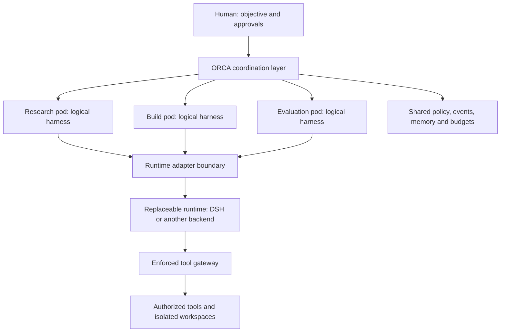

# ORCA
### Experimental pod coordination above replaceable agent runtimes

**Status: design proposal · no working implementation · no benchmark results.**

ORCA explores whether temporary, bounded teams of agents can complete complex work more reliably than a single agent or a fixed team, at an acceptable coordination cost. It combines explicit pod contracts, logical harness boundaries, shared infrastructure, evidence-backed memory, and human-controlled safety gates.

This repository records a proposed architecture and test plan. It does not claim a proven invention, scientific novelty, production readiness, or superiority over existing frameworks. There is no executable product to install.

## The idea

A **skill** is a reusable procedure or capability. An **agent** is an executing worker with context and tools. A **pod** is a bounded assignment and coordination contract for one or more agents: objective, members, permissions, budget, evidence, lifecycle, and acceptance criteria. Adding skills to an agent does not by itself establish that contract.

Each pod has a **logical harness**: its own execution identity, state, policy, resource accounting, and recovery boundary. This does not require a separate server, model, database, or full harness installation for every pod. Shared services must preserve those boundaries.

DeepSeek Harness is a candidate backend, not a dependency today. ORCA is a separate proposal, not a fork or distribution of DeepSeek Harness and not part of NC_Brain. “Harness2” is not a specified public dependency; the design uses the generic logical harness concept instead. No private project code or configurations are included.

## Proposed operating loop

1. Accept an objective, measurable acceptance criteria, and permission ceiling.
2. Start with the smallest adequate pod; select members from a capability registry.
3. Execute through an adapter with bounded tools, budget, time, and memory scope.
4. Re-form or dissolve pods only when justified by evidence and within the original ceiling.
5. Independently verify artifacts; request approval for gated external effects.
6. Record results and propose reusable lessons. Promote lessons only after evaluation.

Dynamic formation and collective memory are hypotheses to test, not automatic improvements. More agents can increase latency, correlated errors, and cost.

## Read the design

| Document | Purpose |
| --- | --- |
| [Architecture](docs/architecture.md) | Components, boundaries, failures, and recovery |
| [Pod specification](docs/pod-specification.md) | Contracts, lifecycle, adapter interface |
| [Biological inspiration](docs/biological-inspiration.md) | Metaphors and their limits |
| [Learning engine](docs/learning-engine.md) | Evidence, memory promotion, rollback |
| [Prior art](docs/prior-art.md) | Sourced comparisons and overlap |
| [Roadmap](docs/roadmap.md) | Phase gates and objective evaluation protocol |
| [RFC 0001](rfcs/0001-orca-architecture.md) | Proposed decisions, alternatives, open questions |
| [License recommendation](docs/license-recommendation.md) | Owner decision still required |

## Safety and publication boundaries

Proposed defaults are local execution, least privilege, denied external effects, scoped memory, and explicit approval for publishing, sending messages, spending, destructive operations, and permission expansion. A prompt instruction is not a security boundary. Runtime enforcement and isolation must be demonstrated before enabling real tools.

Use synthetic or explicitly public data in examples and benchmarks. Do not submit credentials, customer data, internal prompts, private repositories, or business records. A public repository cannot make already copied information private again.

## Contributing and licensing

Feedback on contracts, failure cases, prior art, and benchmark design is welcome through issues. No license has been selected and no open-source license grant is made by this repository. See the recommendation before contributing substantial material; contribution licensing must be resolved before accepting code. Public availability alone is not an open-source license.

ORCA is a working project name; naming and trademark clearance have not been established.
