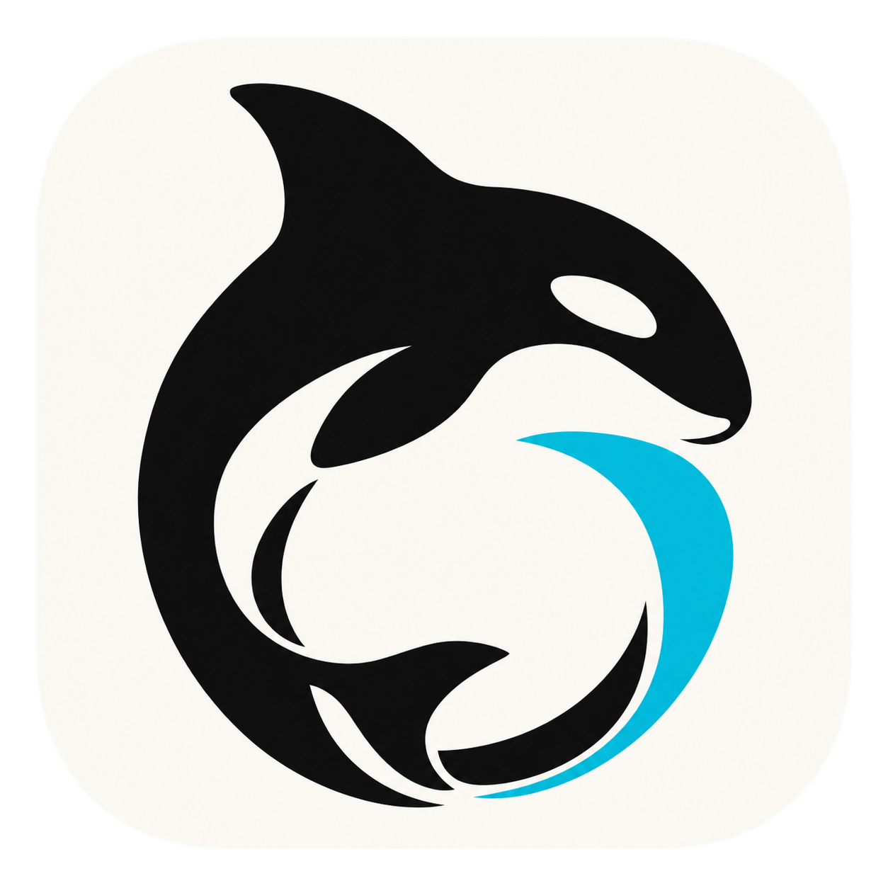
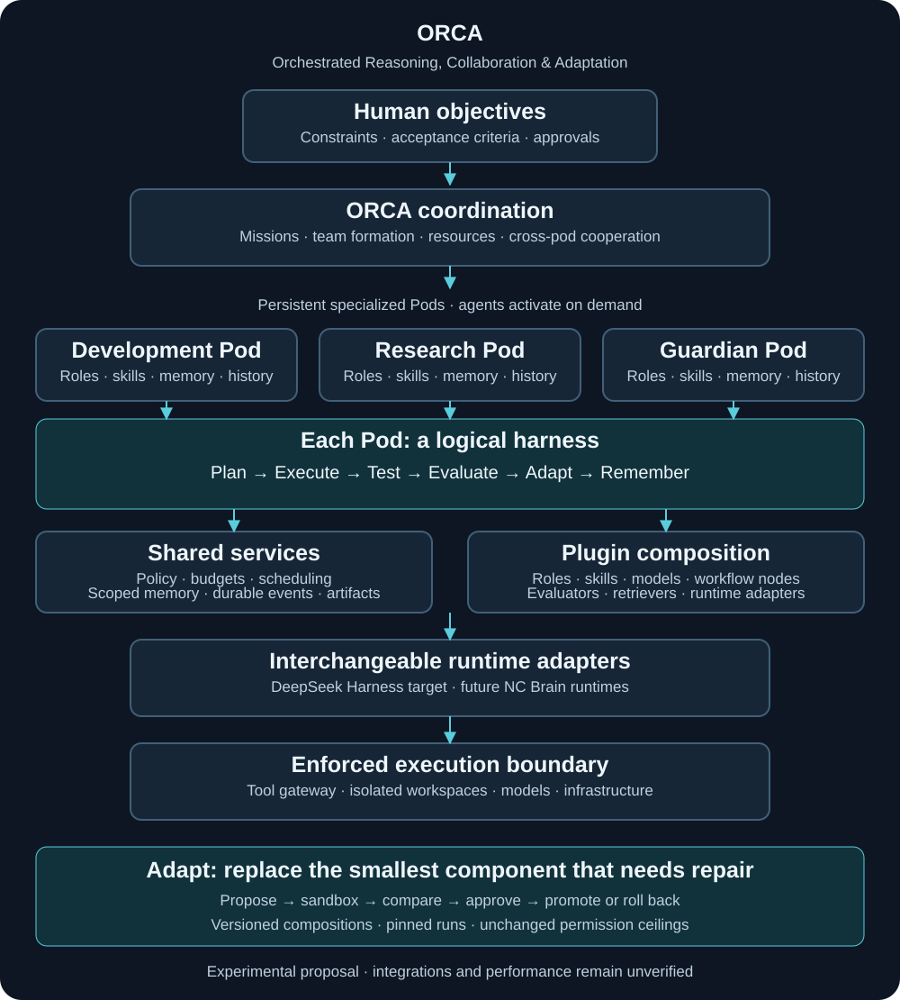

# ORCA — Orchestrated Reasoning, Collaboration & Adaptation

An experimental, bio-inspired orchestration architecture for organizing AI agents into persistent, specialized Pods.

**Status: design proposal · no working implementation · no benchmark results.**

ORCA explores how collective memory, adaptive team formation, distributed coordination, and evidence-driven workflow improvement can make multi-agent systems more reliable and efficient.

Designed to operate above interchangeable agent harnesses, including DeepSeek Harness and future NC Brain runtimes. These integrations are proposed, not implemented.

This repository records a proposed architecture and test plan. It does not claim a proven invention, scientific novelty, production readiness, or superiority over existing frameworks. There is no executable product to install.

## The idea

A **skill** is a reusable procedure or capability. An **agent** is an executing worker with context and tools. A **Pod** is a persistent, specialized team definition with identity, policies, knowledge, preferred workflows, and performance history. A **pod run** is a bounded assignment and coordination contract for one or more activated agents: objective, members, permissions, budget, evidence, lifecycle, and acceptance criteria. Adding skills to an agent does not by itself establish that contract.

Each pod has a **logical harness**: its own execution identity, state, policy, resource accounting, and recovery boundary. This does not require a separate server, model, database, or full harness installation for every pod. Shared services must preserve those boundaries.

[Editable Mermaid source](docs/diagrams.md)

DeepSeek Harness is the initial runtime target to investigate. Future NC Brain runtimes are a portability direction, subject to adapter conformance. ORCA remains a separate repository; this does not change or expose either project's implementation. No private project code or configurations are included.

## Proposed operating loop

1. Accept an objective, measurable acceptance criteria, and permission ceiling.
2. Activate the smallest adequate team from a persistent Pod definition; select members from a capability registry.
3. Execute through an adapter with bounded tools, budget, time, and memory scope.
4. Reconfigure active teams or archive Pod definitions only when justified by evidence and within the original ceiling.
5. Independently verify artifacts; request approval for gated external effects.
6. Record results and propose reusable lessons. Promote lessons only after evaluation.

Each Pod follows **Plan → Execute → Test → Evaluate → Adapt → Remember**. Its team identity and approved knowledge persist while individual runs and model processes can end.

## Everything is a plugin

Building on [DeepSeek Harness’s plugin-first philosophy](https://github.com/deepseek-ai/deepseek-harness), ORCA proposes replaceable role implementations, skills, model routers, workflow steps, evaluators, memory retrievers, and runtime adapters. The Adapt phase identifies a failure, proposes a specific component replacement, tests it in isolation, compares it against a pinned baseline, and promotes or rolls it back. Policy authority and approval ceilings remain outside the replaceable workload plugins.

A fixed workflow is a valid outcome: adaptation may pin a repaired step rather than continually reorganize the team. See [plugin and adaptation specification](docs/plugins-and-adaptation.md).

Dynamic formation and collective memory are hypotheses to test, not automatic improvements. More agents can increase latency, correlated errors, and cost.

## Read the design

| Document | Purpose |
| --- | --- |
| [Plugins and adaptation](docs/plugins-and-adaptation.md) | Replaceable parts, validation, promotion and rollback |
| [Architecture](docs/architecture.md) | Components, boundaries, failures, and recovery |
| [Pod specification](docs/pod-specification.md) | Contracts, lifecycle, adapter interface |
| [Biological inspiration](docs/biological-inspiration.md) | Metaphors and their limits |
| [Learning engine](docs/learning-engine.md) | Evidence, memory promotion, rollback |
| [Prior art](docs/prior-art.md) | Sourced comparisons and overlap |
| [Roadmap](docs/roadmap.md) | Phase gates and objective evaluation protocol |
| [RFC 0001](rfcs/0001-orca-architecture.md) | Proposed decisions, alternatives, open questions |
| [License recommendation](docs/license-recommendation.md) | Owner decision still required |

## Safety and publication boundaries

Proposed defaults are local execution, least privilege, denied external effects, scoped memory, and explicit approval for publishing, sending messages, spending, destructive operations, and permission expansion. A prompt instruction is not a security boundary. Runtime enforcement and isolation must be demonstrated before enabling real tools.

Use synthetic or explicitly public data in examples and benchmarks. Do not submit credentials, customer data, internal prompts, private repositories, or business records. A public repository cannot make already copied information private again.

## Contributing and licensing

Feedback on contracts, failure cases, prior art, and benchmark design is welcome through issues. No license has been selected and no open-source license grant is made by this repository. See the recommendation before contributing substantial material; contribution licensing must be resolved before accepting code. Public availability alone is not an open-source license.

ORCA is a working project name; naming and trademark clearance have not been established.
