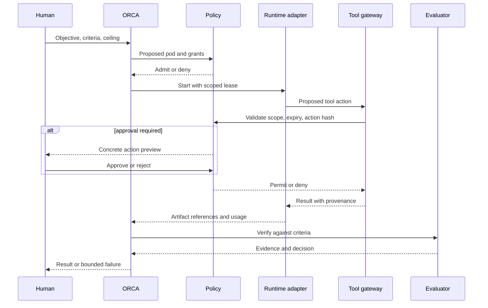

# Architecture
Status: proposed. Normative words describe intended requirements, not implemented guarantees.

## Scope and layering
ORCA owns objective decomposition, pod membership, cross-pod dependencies, aggregate budgets, policy decisions, and evidence-based evaluation. A replaceable runtime owns agent execution mechanics. Adapters translate between them without silently weakening policy.

A logical per-pod harness includes a unique identity, isolated context namespace, lifecycle state, capability grants, usage ledger, checkpoint references, and tool mediation. Several such harnesses may share a runtime service. Separate processes or containers are required where the threat model demands stronger isolation; a namespace alone is insufficient.

## Components
| Component | Responsibility | Boundary |
| --- | --- | --- |
| Objective controller | Acceptance criteria and dependency graph | Cannot authorize new privileges |
| Pod planner / registry | Capability matching and bounded formation | Proposes; policy admits |
| Policy service | Deny-by-default grants and approvals | Outside model control |
| Scheduler / budget ledger | Leases, quotas, cancellation | Atomic aggregate reservations |
| Adapter | Start, events, checkpoints, cancellation | Reject unsupported requirements |
| Tool gateway | Validate grants at effect time | No unmediated tool access |
| Event / artifact store | Durable traces and content hashes | Scoped reads, retention policy |
| Memory service | Retrieval and reviewed promotion | Tenant and objective access controls |
| Evaluator | Acceptance checks and adverse-event review | Cannot approve its own effects |

## Control and data paths

Approval binds actor, target, operation, artifact hash, cost ceiling, policy version, and expiry. Changing the payload invalidates approval. Tool credentials stay in the gateway or secret broker; models receive opaque capability references. Cross-pod communication is typed messages and authorized artifact references, not unrestricted shared transcripts.

## Invariants
- Child grants are subsets of parent grants. Re-formation never resets budgets or approval requirements.
- Budgets cover all descendants and retries. Reserve before scheduling; settle actual usage afterward.
- Memory content, retrieved pages, tool output, and peer messages are untrusted data, never policy authority.
- A pod cannot mark its own artifact accepted merely by reporting success.
- Effects require a live grant at execution time. Revocation blocks new effects immediately.
- Each run pins policy, adapter, model, prompt, and specification versions.

## Shared infrastructure without shared authority
A deployment may share model endpoints, queues, storage, observability, and credentials infrastructure. Every request carries tenant, objective, pod, run, and policy identifiers, authenticated by the service rather than supplied solely by a model. Storage queries enforce scope before similarity search and before returning results. Separate stores are an option for stronger confidentiality requirements.

## Dynamic formation
Start with one pod and add workers only for unmet capabilities, independently checkable work, or a stalled dependency. Estimate incremental benefit against coordination cost. Bound membership, depth, concurrent pods, retries, and formation frequency. Recomposition creates a new specification revision and records why it occurred. Transfer only authorized evidence and remaining reservations. Failed splits return to the smallest safe configuration; there is no unlimited recursive spawning.

## Failure and recovery
Use durable state transitions with compare-and-swap revisions, leases, and monotonically ordered per-run events. Transport is assumed at-least-once; deduplicate by event and action IDs. Checkpoint recovery revalidates grants and budget. Do not promise exactly-once external effects: use provider idempotency keys where supported, otherwise reconcile observable effect state before retrying. Ambiguous sends or purchases require human review.

A lost worker expires its lease. A policy outage fails closed. A memory outage permits only tasks whose contract allows no-memory operation. A runtime without enforceable cancellation may finish computation, but its revoked tool grants must prevent further effects. Mark uncertain usage and reserve conservatively until reconciliation.

## Threats and limits
Prompt injection, memory poisoning, compromised plugins, reviewer collusion, privilege escalation, cross-tenant leakage, and duplicated effects are explicit threats. Independent review helps only when independence is real; model agreement is not truth. OS/network isolation, authorization tests, and adversarial fixtures are prerequisites for claims of containment.

Open questions include trusted deployment boundaries, adapter portability costs, event-store choice, and practical isolation overhead. See [RFC 0001](../rfcs/0001-orca-architecture.md).
