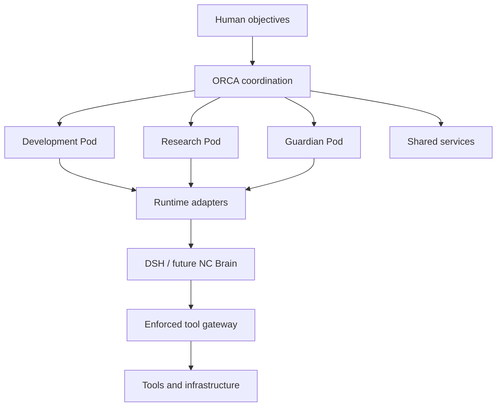
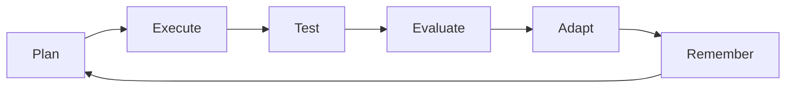
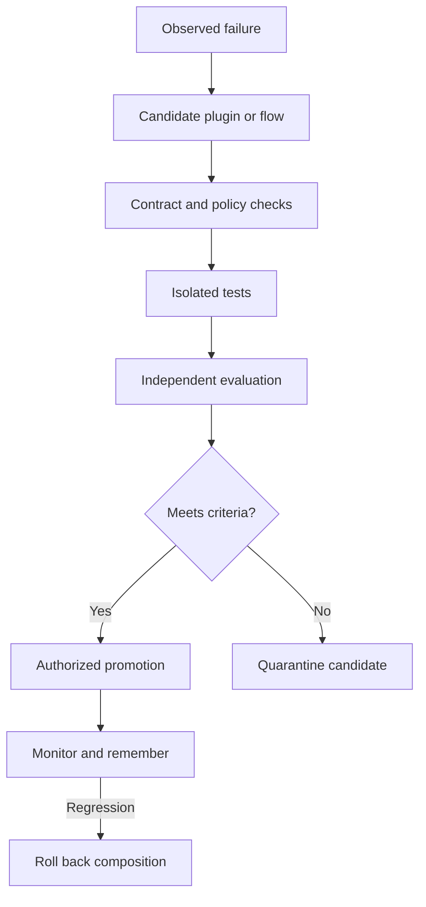

# Editable diagrams
The README uses a native SVG with explicit text positioning to avoid clipped labels in GitHub's Mermaid rendering. [SVG source](../assets/orca-architecture.svg).
## Architecture

Pods retain identity and approved knowledge across bounded runs. Shared services enforce policy, scoped memory, aggregate budgets and durable coordination.
## Pod cycle

## Plugin repair

