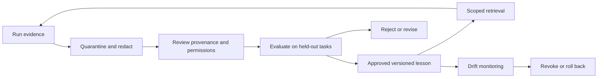

# Learning engine and collective memory
Status: proposed; no online learning or model-weight training is implemented.

## What learning means here
The first experiment concerns retrieval and versioned procedural improvement: selecting better task templates, team compositions, and verified lessons. It does not imply autonomous self-modification, weight updates, or unconstrained optimization.

Collective memory is a governed evidence store, not a universal transcript. Pod-local working context expires with its retention policy. Objective memory supports coordination. Organization-level knowledge requires separate promotion and scope approval.

## Record contract
Each candidate record includes record_id, version, scope, source artifact hashes, originating run IDs, claim, supporting and contradicting evidence, task tags, privacy classification, confidence basis, reviewer identity, creation time, review time, expiry, and supersedes/revokes references. Store observations separately from derived recommendations. Model self-confidence is not calibrated evidence.

## Promotion rules
1. Admit only records with authorized sources and reproducible artifact references.
2. Redact secrets and private data before indexing; deny uncertain classification.
3. Verify the claim independently and record failure cases.
4. Compare the candidate against the previous lesson on a held-out task family.
5. Promote only with reviewer approval, bounded scope, expiry, and rollback reference.

A single successful run creates an observation, not a general rule. Contradictory evidence remains visible. Retrieval returns source, version, scope, and uncertainty with each item; it never turns an instruction from memory into policy authority.

## Adaptation limits
Team selection may initially use a transparent score combining required capability coverage, observed task-family success, latency, cost, and uncertainty. Use fixed rules before a learned selector. Log alternatives and selection rationale. Cap exploration budget and permit exploration only on synthetic or explicitly approved tasks. Protected attributes and private customer profiles are excluded.

Policy, approval gates, permissions, and spending ceilings cannot be relaxed by learned recommendations. A proposed change to a prompt, skill, or planner is a versioned artifact subject to evaluation and review.

## Evaluation and deletion
Measure precision of retrieved lessons, unsupported-memory rate, correction rate, stale-record use, privacy violations, and task performance with memory enabled versus disabled. Detect contamination by separating training, selection, and held-out evaluation sets. A revoked source invalidates derived records; deletion must cover indexes, caches, and documented backup retention. Published benchmark artifacts must use sanitized fixtures.

Rollback restores a previous approved lesson set and invalidates affected retrieval caches. Retain a minimal non-sensitive revocation audit. If an improvement disappears on held-out tasks, report that result and keep the simpler baseline.

## Adapt: repair a component, retain a team
Persistent Pods accumulate scoped evidence across runs. Adapt converts an observed failure into a proposed plugin or flow revision. Example: unsupported citations trigger a candidate citation-checker replacement; a weak result does not justify changing all agent prompts at once. The candidate must outperform or repair the pinned baseline under predefined checks before promotion. Remember records the accepted revision, evaluation evidence and rollback target; rejected candidates remain quarantined.

Promotion changes organizational procedures and configuration, not model weights. Cross-pod transfer is opt-in and scope-checked: a lesson proven in research is a candidate, not automatically valid for development. See the [plugin replacement protocol](plugins-and-adaptation.md).
