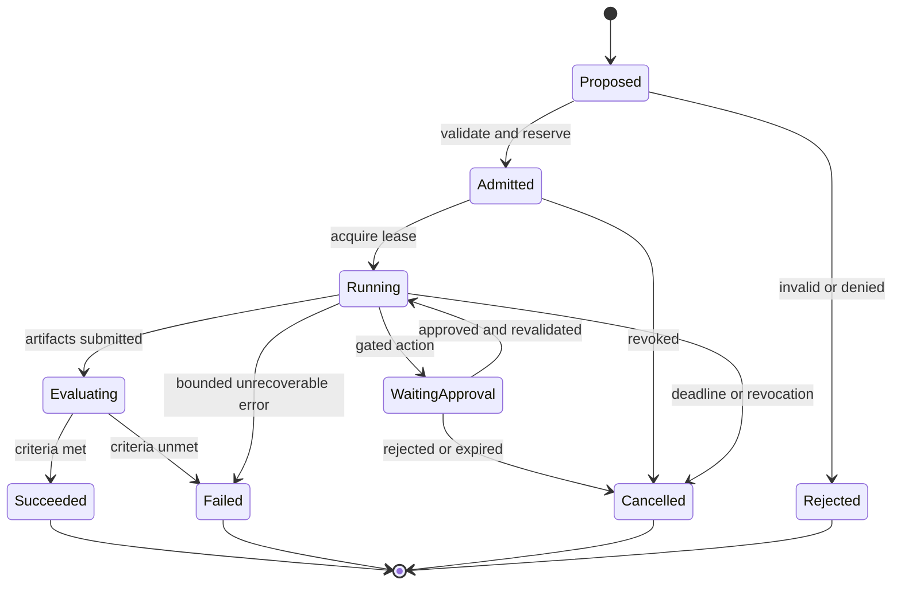

# Pod specification
Status: proposed v0.1 contract; YAML below is illustrative, not a validated configuration format.

## Terms
An agent executes a role; a skill supplies reusable instructions or capability. A persistent Pod owns its identity, specialty, approved memory, workflow composition and history. Each pod run owns a bounded objective and acceptance contract. Pods may activate one agent. A logical harness enforces the pod's context, tool, budget, lifecycle, and recovery boundaries. No physical runtime-per-pod requirement is implied.

## Example
```yaml
spec_version: "0.1"
pod_id: pod-example-001
objective_id: objective-example-001
revision: 1
objective: "Compare two public technical documents with source citations"
inputs:
  - artifact_ref: public-document-a
  - artifact_ref: public-document-b
acceptance:
  - "Every factual comparison links to supplied evidence"
  - "Unsupported claims are marked uncertain"
members:
  - agent_id: researcher
    skills: [source-comparison]
  - agent_id: reviewer
    skills: [evidence-verification]
runtime:
  adapter: mock
  required_features: [scoped_tools, usage_events, cancellation]
capabilities:
  tools: [artifact.read, artifact.write_draft]
  network_destinations: []
  secret_refs: []
memory:
  read_scopes: [objective-example-001]
  proposed_write_scope: quarantine
budget:
  max_model_tokens: 12000
  max_cost_usd: 1.00
  max_wall_seconds: 180
  max_tool_calls: 20
formation:
  max_members: 2
  max_child_pods: 0
  max_revisions: 2
approval:
  external_effects: required
output:
  artifact_type: comparison-report
  evidence_required: true
```

Values are demonstration limits, not expected performance. Registry identifiers refer to versioned records; an agent cannot choose its own grant.

## Required semantics
Validate IDs, schema version, nonempty objective, measurable acceptance criteria, input permissions, allowed output locations, members, adapter features, deadlines, and nonnegative budgets before admission. Cost accounting must distinguish estimated and billed cost; deny a paid call if its worst-case reservation cannot fit. Missing or unknown security fields fail admission. Capability claims from skills do not confer permission.

The effective grant is the intersection of organization policy, objective ceiling, pod request, runtime enforcement capability, and current approval. Every nested pod shares the objective's aggregate limits.

## Run lifecycle
This state machine describes one bounded execution, not the lifetime of the persistent Pod. Definitions move through Draft → Active → Archived separately; historical runs retain their original definition and composition revisions.



Retries create attempt IDs and debit the same budget. Re-formation creates a new revision after checkpointing or cancelling affected work; it does not rewrite historical membership. Approval waits retain a bounded expiry and release idle execution resources where supported.

## Runtime adapter contract
| Operation | Required behavior |
| --- | --- |
| describe_capabilities() | Versioned features and enforcement limitations |
| start(spec, grant, lease) | Return run ID; reject unsupported requirements |
| events(run, cursor) | Ordered per-run events, replay cursor, deduplication IDs |
| checkpoint(run) | Return opaque, scoped checkpoint reference or explicit unsupported error |
| resume(checkpoint, grant, lease) | Revalidate authorization; never reuse expired grants |
| cancel(run, reason) | Acknowledge receipt and report eventual terminal status |
| usage(run) | Tokens, tool calls, elapsed time, cost basis and uncertainty |
| collect_artifacts(run) | Immutable references, hashes, provenance and visibility |

Minimum event envelope: event_id, event_type, timestamp, objective_id, pod_id, spec_revision, run_id, attempt_id, sequence, policy_version, payload_ref. Avoid raw credentials and private prompts in events.

Task results include status, acceptance evidence, artifact references, actual/estimated usage, errors, and limitations. A successful runtime exit is distinct from an accepted objective.

## Conformance cases
A future adapter must demonstrate grant narrowing, blocked unapproved effect, cancellation, replay deduplication, recovery after interruption, aggregate budget exhaustion, and denied cross-scope memory reads. An adapter that cannot mediate tools may be used only for synthetic computation with external access disabled.

## Persistent definition and composition
Separate pod_definition_id and definition_revision from pod_run_id and attempt_id. A definition records specialty, role slots, approved memory namespace, composition manifest hash and approved plugin versions. Each run references that immutable revision plus its mission-specific grant. Registry agent definitions and skills may be reused across Pods; credentials, transcripts and mutable contexts are not implicitly shared.

The logical harness cycle is Plan → Execute → Test → Evaluate → Adapt → Remember. Persist approved lessons and configuration changes without keeping model processes alive. A plugin swap increments composition_revision; current runs stay pinned unless an explicit checkpoint migration is validated. See [plugins and adaptation](plugins-and-adaptation.md).
